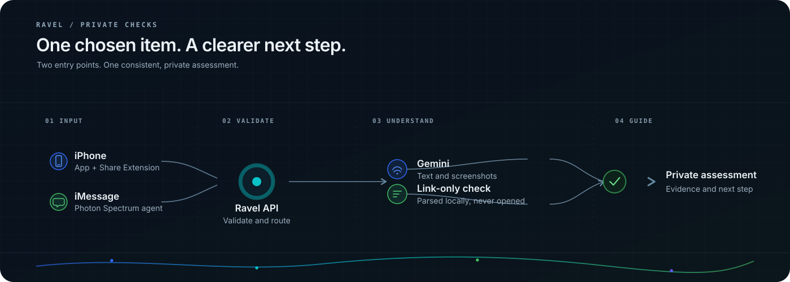

<p align="center">
  
</p>

<h1 align="center">Ravel</h1>

<p align="center"><strong>Clarity for what feels off.</strong><br>
Private message, screenshot, and link checks on iPhone and iMessage.</p>

<p align="center">SwiftUI · Google Gemini · Photon Spectrum</p>

<p align="center">
  
</p>

## What it does

Ravel gives people a second look at a suspicious item without asking for access to their conversations. They choose what to check, then receive a concise assessment with supporting observations and a practical next step.

- **iPhone:** check a screenshot from Photos, paste a message or link, or share supported content to Ravel from another app.
- **iMessage:** send a message to the Ravel line powered by Photon Spectrum. The agent checks text through the same backend and replies with the result.
- **Evidence, not certainty:** Gemini extracts structured observations from selected text and screenshots. A result can be suspicious, insufficient evidence, or require human review.
- **Link-only checks:** parse the URL locally. Ravel does not open the destination or run a reputation lookup.
- **Private by default:** a check does not create a community report. Background message scanning and community reporting are not part of this build.

Gemini observations are not proof of fraud, and missing evidence does not prove safety. Ravel only processes the item a person deliberately selects or sends.

## Run locally

### Requirements

- Python 3.12+
- Node.js 22.20 or newer for the Photon agent
- macOS with Xcode and XcodeGen 2.42 or newer to build the iPhone app

### Start the fixture backend

This credential-free mode uses clearly labeled synthetic results and makes no Gemini or Photon calls. From the repository root:

```sh
python3 -m venv .venv
.venv/bin/python -m pip install -r backend/requirements.lock
.venv/bin/python -m pip install --no-deps -e './backend[dev]'
RAVEL_FIXTURE_MODE=true .venv/bin/python -m uvicorn app.main:app \
  --host 127.0.0.1 --port 8001 --no-access-log
```

In another terminal, verify the API is up:

```sh
curl -sS http://127.0.0.1:8001/health
```

### Run the iPhone app

Set up the local Xcode signing settings and backend address in the ignored `ios/Configuration/Developer.xcconfig`, then generate and open the project:

```sh
sh ios/generate-project.sh
open ios/Ravel.xcodeproj
```

In Xcode, select the **Ravel** scheme and a connected iPhone. For a physical device, point the app at the Mac's private LAN address and bind the development backend to that address. See [iOS setup](ios/README.md) for signing and local-network details. Never put a Gemini key in the iOS app.

### Enable Gemini and Photon

For connected checks, copy `.env.example` to the ignored root `.env` (`cp .env.example .env`) and add server-side `GEMINI_API_KEY`, `GEMINI_MODEL`, `SPECTRUM_PROJECT_ID`, and `SPECTRUM_PROJECT_SECRET`. Set `RAVEL_FIXTURE_MODE=false` and `RAVEL_API_BASE_URL` to the backend address. Keep credentials out of source control and the mobile app. Start the connected backend with:

```sh
RAVEL_FIXTURE_MODE=false .venv/bin/python -m uvicorn app.main:app \
  --host 127.0.0.1 --port 8001 --no-access-log
```

Install and test the Photon agent:

```sh
npm --prefix photon-agent ci --ignore-scripts
npm --prefix photon-agent test
```

For a live, owner-filtered demo, start the backend in Gemini mode, confirm `/health` reports `mode: gemini`, then start the listener with the **sender's own** iMessage number:

```sh
npm --prefix photon-agent start -- --live --sender "$OWNER_E164"
```

Replace `$OWNER_E164` with the sender's own E.164 number. Send a synthetic test message from that number to the Photon project's assigned **Texts on** number. Keep the Mac, backend, and listener running. The listener stops after 30 minutes or 20 accepted messages; this is a bounded demo session, not an always-on service. See [Photon setup](photon-agent/README.md) and the [demo guide](docs/demo-script.md).

## Tests

```sh
.venv/bin/python -m pytest backend/tests
npm --prefix photon-agent test
swift test --package-path ios/RavelCore
```

These tests use fixtures and synthetic inputs; they do not replace live provider or on-device checks.

## Credits

Core integrations: **Apple SwiftUI and Share Extension**, **Google Gemini API** through the Google Gen AI Python SDK, and **Photon Spectrum** for the iMessage agent. The backend uses FastAPI and Pydantic; the Photon agent uses Node.js, TypeScript, and Zod. The iOS project is generated with XcodeGen. **Tiger Data is not integrated** in this build. See the [presentation-ready credits list](docs/credits.md).

## Project notes

- [Privacy and Gemini data handling](docs/gemini.md)
- [iOS setup and limitations](ios/README.md)
- [Photon setup](photon-agent/README.md)
- [Controlled demo steps](docs/demo-script.md)
